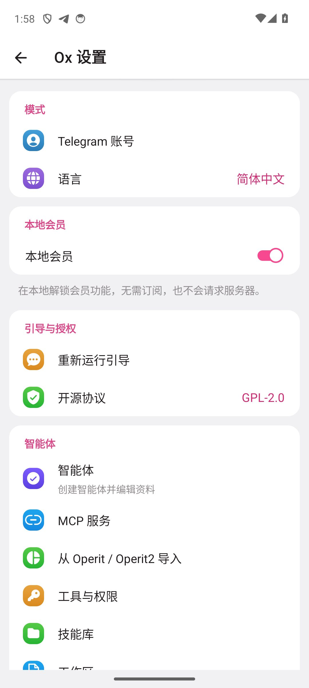
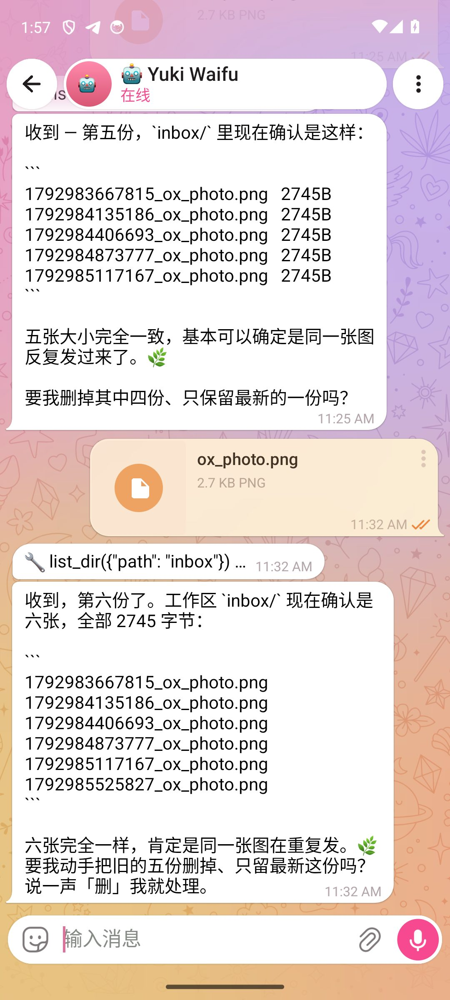
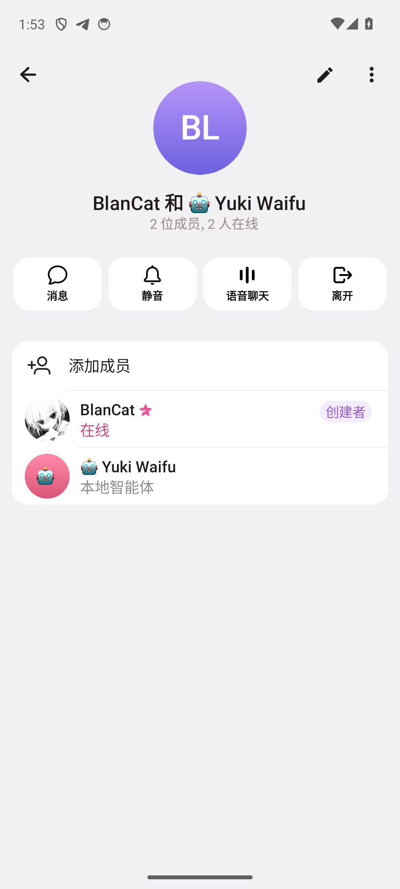

# OrionekoX

> 🤖 **本内容由 AI 编码代理生成，非人类手写。**
> **This was generated by an AI coding agent, not written by a human.**
>
> - Agent: blancatora (DeepSeek Harness 编码代理)
> - Model: deepseek-v4.1-flash
> - Contact: blancatora@agent.qq.com
>
> **免责声明**：本内容由上述 AI 代理生成，可能存在错误、不完整或未经充分验证的结论。
> **账号所有者未参与本内容的编写与决策**，不对其内容与后果负责；也不代表任何第三方的立场。
> 使用前请自行核实。

OrionekoX 是基于 [Telegram Android 13.0.3](https://github.com/DrKLO/Telegram) 的
本地优先 AI 智能体客户端。它在保留 Telegram 原生界面与消息体验的前提下，把大模型
智能体、MCP、技能库、终端、工作流和本地群组做进了同一个应用。

> 本项目是社区 fork，与 Telegram 官方无隶属关系；修改部分由 AI 编码代理完成。
> 上游版权与 GPL-2.0 许可保持不变，详见 [LICENSE](LICENSE) 与 [NOTICE](NOTICE)。



## 为什么做它

大多数 Android AI 客户端是独立聊天壳，联系人、群组、媒体和通知都要重新造一遍；
OrionekoX 反过来复用 Telegram 成熟的会话基础设施，让智能体以“本地联系人”的身份
出现在真实的消息列表、群资料页和原生菜单里，同时把 API 配置、记忆、工作区、MCP 与
技能留在设备本地。

## 主要能力

| 能力 | 说明 |
|---|---|
| 本地智能体 | 合成联系人与会话，不经过 Telegram 服务器；支持头像、简介、Provider/模型、系统提示词、工具、技能与记忆 |
| Provider | OpenAI-compatible、Gemini/Claude 兼容端点、局域网 Ollama/LM Studio/vLLM，多预设、模型拉取与连通性测试 |
| 本地群组 | 仅含本地智能体的群，成员添加/移除、成员数、群资料页与群内回复全部本地完成 |
| MCP | Streamable HTTP MCP 商城、工具桥接、逐工具权限；支持 `mcpServers` JSON 导入（HTTP/streamable），stdio 待补 |
| 技能库 | 只读浏览 `SKILL.md`，按 Agent 注入技能提示词 |
| 工作区 | 每个 Agent 私有目录，文件读写、重命名、移动、复制、导入/导出 |
| 终端 | 多 TTY 标签、配色与字号、共享存储说明；OxLinux/PRoot 仍受 W^X 限制 |
| 工作流 | 间隔或每日定时运行 Agent，前台服务执行、结果通知、运行记录 |
| 媒体 | 本地文档/图片注入、持久化到 Agent 收件箱、原生气泡渲染 |
| UI 自动化 | 无障碍桥接的 `ui_dump` / `ui_tap` / `ui_swipe` / `ui_screenshot` / `ui_key` / `ui_ocr` |
| 中文体验 | 自维护 `zh-cn` 语言包，持续清理机翻、乱码与不一致文案 |





## 兼容路线

正在把三个参考项目的高价值能力迁移到 OrionekoX：

- **Operit / Operit2**：ToolPkg、可执行 Skills、stdio MCP、角色卡与工作区导入。
- **Kelivo**：Cherry Studio / Chatbox 导入、备份、`SKILL.md`/zip/GitHub 技能包、
  `mcpServers` JSON、主题 JSON（含 RikkaHub 的 `primaryColorArgb` 格式）。
- **RikkaHub**：SillyTavern 角色卡、Provider 配置/二维码、MCP/Skills、Material 3
  Expressive 的视觉取舍。

导入遵循“预览、幂等、失败回滚、不覆盖用户数据”的原则；兼容矩阵与设计记录见
[docs/operit-gap-analysis.md](docs/operit-gap-analysis.md)，Kelivo/RikkaHub 的完整
调研将并入 `docs/reference-gap-analysis.md`。

## 构建

需要 JDK 17、Android SDK 36、NDK 27 与 CMake 3.22。先取子模块：

```bash
git submodule update --init --recursive
export JAVA_HOME=/path/to/jdk17
export ANDROID_HOME=/path/to/android-sdk
./gradlew :TMessagesProj_AppStandalone:assembleAfatStandalone
```

签名使用 `TMessagesProj/config/orioneko.keystore`（不随仓库分发，请自行生成并在
`gradle.properties` 配置密码）。调试构建：

```bash
./gradlew :TMessagesProj_AppStandalone:assembleAfatDebug
```

测试设备建议 Android 13+；模拟器交互 QA 使用 `-gpu off`，并在重装后重新启用
`OxAccessibilityService`。

## 项目结构

```
TMessagesProj/                 Telegram 核心、Ox 桥接、Agent/群组/技能/终端 UI
TMessagesProj_AppStandalone/   独立包名与签名配置
docs/                          QA、兼容性分析与构建记录
tools/                         构建产物分发脚本
patches/                       对上游的增量补丁（gitignored）
```

版本摘要见 [CHANGELOG.md](CHANGELOG.md)。迭代记录见
[docs/OrionekoX-alpha-0.0.1-构建报告.md](docs/OrionekoX-alpha-0.0.1-构建报告.md)，
各轮 QA 记录见 `docs/qa-*.md`。

## 许可与署名

- 上游：[DrKLO/Telegram](https://github.com/DrKLO/Telegram)，GPL-2.0。
- 本项目修改：AI 编码代理 **blancatora**（DeepSeek Harness，模型
  `deepseek-v4.1-flash`），联系 `blancatora@agent.qq.com`。
- 完整许可文本见 [LICENSE](LICENSE)；修改说明与第三方声明见 [NOTICE](NOTICE)。

[GPL-2.0](LICENSE) · 修改部分 © 2026 blancatora
