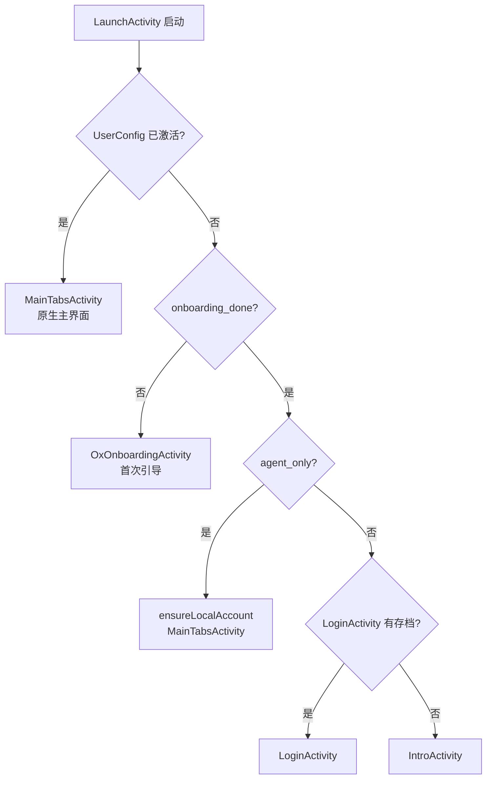
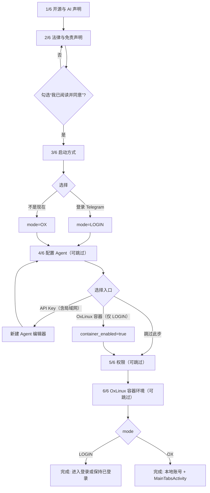
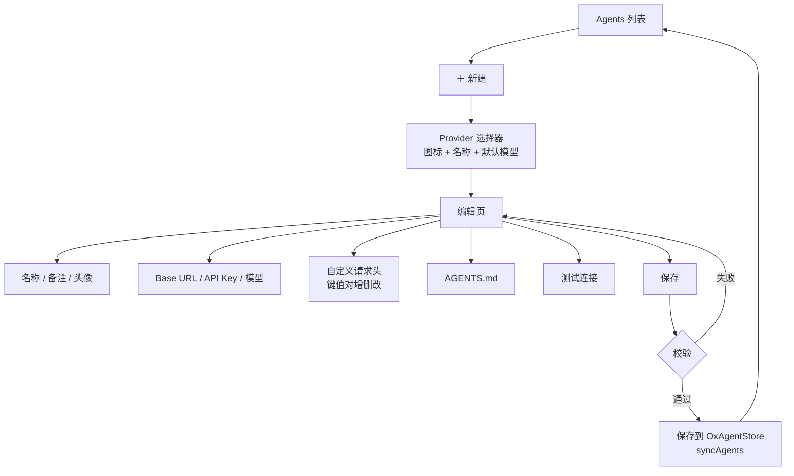
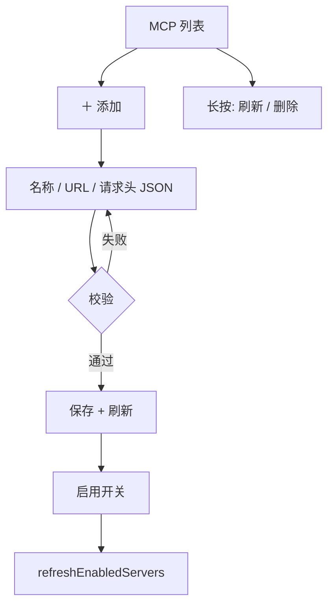

# OrionekoX 界面与导航流程（唯一事实来源）

本文把 Ox 自写页面的路由、引导分支、模式切换和返回栈画成流程图。代码改动先对照本文，
再改实现；实现与图不一致时，以本文为准并同步更新。

## 1. 启动路由



规则：

- Ox 模式的“主页”就是 `MainTabsActivity`，与正常登录完全一致；
  不再从引导页 `presentFragment(new DialogsActivity())` 另起一套主页。
- 引导页只负责“决定模式”，不负责长期停在栈里。完成后必须把自己从返回栈移除。
- 首次引导只出现一次（`onboarding_done`）；之后从 `Ox 设置 → 重新运行引导` 进入。

## 2. 六步引导（修正后的分支）



关键修正：

1. **第 3 步不再直接结束引导**。两个选项只设置 `mode`，仍继续第 4–6 步；
   最后一步的主按钮根据 `mode` 变成“登录 Telegram”或“开始使用”。
2. **第 4 步不再跳页**。容器入口只置 `container_enabled`，不打断 4→5→6 的顺序，
   步数始终真实。
3. **第 4 步不再预创建占位 Agent**。打开新建编辑器，取消/返回不会留下
   “API Agent / LAN Agent”垃圾数据；重复运行引导也不会重复创建。
4. **第 2 步必须显式同意**。未勾选时主按钮禁用（视觉置灰），避免“下一步”被误触。
5. **步数固定 6 步**。第 4–6 步可“跳过此步”，但页面本身仍计入步数，不再出现
   “第 4 步 → 第 6 步”的计数谎言。
6. **局域网 Agent 归入 API Key**。第 4 步只有“API Key（含 Ollama/LM Studio/vLLM/opencode 等
   局域网设备）”和“OxLinux 容器（Bot 兼容）”两个入口；后者只在第 3 步选择
   “登录 Telegram”时出现，Ox 模式下隐藏。
7. **跳过提示只在第 4–6 步显示**。第 1–3 步隐藏提示但保留固定高度，主按钮不移动。

## 3. 底部操作区（位置固定）

```text
┌────────────────────────────────────┐
│  第 3 步 / 共 6 步 · 还剩 3 步      │  ← 顶部：圆点 + 步数（固定）
│                                    │
│  页面内容（可滚动）                 │
│                                    │
│  可跳过；之后可在 Ox 设置中修改      │  ← 固定提示
│  退出引导            跳过此步       │  ← 固定次级行（左/右槽位）
│  ┌──────────────────────────────┐  │
│  │            下一步             │  │  ← 固定主按钮（48dp）
│  └──────────────────────────────┘  │
└────────────────────────────────────┘
```

- `下一步 / 登录 Telegram / 开始使用`：主按钮，始终同一位置、同一尺寸。
- `跳过此步`：仅第 4/5/6 步可用；不可用时 `INVISIBLE` 占位，绝不改变主按钮位置。
- `退出引导`：始终同一位置。首次运行 = 以默认 Ox 模式完成；再次运行 = 直接关闭，不改变模式。
- 提示文案只在第 4–6 步显示：`你可以先跳过此设置；之后可在 Ox 设置 → 重新运行引导 中修改。`
- 内容区与底部操作区是两个独立的垂直区块，操作区不再覆盖页面内容；长页面滚动，
  最后一行可以完整滚入视野。
- 返回：ActionBar 返回箭头 = 上一步；第 1 步隐藏。系统返回键同 ActionBar。

## 4. 模式切换与登出

```mermaid
flowchart TD
    T[引导最后一步] --> Q{目标模式 == 当前模式?}
    Q -- 是 --> R[完成引导<br/>finishFragment 或 MainTabs]
    Q -- 否 --> W{当前已登录真实账号?}
    W -- 是 --> C[红色确认框<br/>说明会退出登录并清理该账号数据]
    W -- 否 --> N[直接切换]
    C --> P[setPendingMode + performLogout]
    N --> P
    P --> H{LaunchActivity 收到 appDidLogout}
    H -- pending=LOGIN --> L[reset 栈为 LoginActivity]
    H -- pending=OX --> O[setAgentOnly(true)<br/>ensureLocalAccount<br/>reset 栈为 MainTabsActivity]
```

- 只有用户显式确认后才 `performLogout`；不自动清任何用户数据。
- `OxAgentsBridge.exitAgentOnly()` 不再被菜单直接调用；迁移到上面的统一流程。
- 切换完成后返回栈只剩目标根页面，不存在 `[主页, 设置, 登录, 主页]` 这种叠加。

## 5. 自写页面返回栈

| 页面 | 进入方式 | 返回行为 |
|---|---|---|
| `OxOnboardingActivity` | 首启 / Ox 设置 | 上一步；第 1 步关闭；完成后从栈移除 |
| `OxSettingsActivity` | 抽屉 / Agents | `finishFragment()` 回上一页 |
| `OxAgentsActivity` | 抽屉 / 设置 | `finishFragment()` |
| `OxAgentProfileActivity` | Agents / 引导第 4 步 | `finishFragment()`，不重建主页 |
| `OxMcpActivity` | 抽屉 / 设置 | `finishFragment()` |
| `OxAgentChatActivity` | 仅非 Ox 模式兜底 | `finishFragment()` |

禁止事项：

- 禁止从二级页 `presentFragment(new DialogsActivity(...))` / `new MainTabsActivity(...)`。
- 禁止 `presentFragment(..., true)` 后仍期望回到被移除的二级页。
- 所有“回主页”统一走 `OxNav.resetToHome()`；所有“去登录”统一走
  `OxNav.resetToLogin()`；所有“模式切换”统一走 `OxNav.switchMode(mode, activity)`。

## 6. Agent / Provider 配置



- Provider 预设集中在一个类里（32 个，含 DeepSeek V4 / OpenAI GPT-5.x / Claude 5 /
  Gemini 3.8 / OpenRouter / Kimi K3 / Qwen 3.8 / GLM 5.3 / MiniMax M3 / OpenCode Zen /
  CommandCode / OpenDesign / 自定义 BYOK / 本地 Ollama、LM Studio、vLLM、opencode serve）。
- Provider 选择器是半屏底部弹层，列表可滚动；每个服务商有独立品牌矢量图标。
- 编辑页提供“从 API 获取模型列表”（GET `/models`，带 Key 与自定义头）、接口地址 /
  Key / 模型分区标签、Key 眼睛显隐、获取 Key、测试连接。
- 高级参数：Temperature、Top P、最大输出 tokens（0=自动）、上下文长度（0=自动；
  用于历史消息的粗略裁剪）。
- 自定义请求头存 `OxAgent.headers`（`[[name, value], ...]`），发送前写入 HTTP 头；
  拒绝 CR/LF，避免头注入。选择 OpenRouter / Anthropic 时会自动补齐其必需/推荐头。
- 新建使用草稿对象，只有“保存”才落盘；取消不产生数据。

## 7. MCP



- 返回栈与上表一致；刷新/删除只改列表，不跳页。

## 8. 已发现并修正的问题清单

| # | 旧行为 | 问题 | 修正 |
|---|---|---|---|
| 1 | 第 3 步任一选项直接 `finishOnboarding` | 第 4–6 步永远不可达；`choseLogin` 成死代码 | 选项只设模式，继续流程 |
| 2 | 第 4 步容器入口 `setCurrentItem(5)` | 跳过第 5 步，步数跳变 | 只置开关，顺序前进 |
| 3 | 第 4 步立即保存占位 Agent | 取消也留垃圾，重复引导重复创建 | 草稿 + 保存才落盘 |
| 4 | 完成引导 `presentFragment(new DialogsActivity())` | Ox 模式主页与启动路由不一致 | 统一用 `MainTabsActivity` |
| 5 | 再次运行引导选“不是现在”会 `setAgentOnly(true)` | 已登录用户被强制切模式 | 再次运行只关闭，不改模式 |
| 6 | `skipButton` 在部分页 `GONE` | 主按钮上下跳动 | 固定槽位 + `INVISIBLE` |
| 7 | 退出/跳过/下一步样式相同 | 三个动作无法区分 | 位置 + 文案 + 主次层级区分 |
| 8 | 无页面切换/按钮按压动效 | 不像 Telegram | `ScaleStateListAnimator`、页面视差淡入、步数淡入、勾选缩放 |
| 9 | Ox 模式仍走 `ConnectionsManager` | 后台一直连 Telegram | Ox 模式禁 `setUserId`/`sendRequest`/语言包下载，连接状态本地化 |
| 10 | 中文本地化只覆盖 fork 字符串 | 上游界面仍为英文 | 内置完整 zh-Hans 语言包 + 中文系统自动选择 |
| 11 | 第 4 步同时给“局域网”和“Bot 兼容其他设备” | 未登录无法用 Telegram Bot 兼容；局域网本质是 API | 局域网并入 API Key；Bot 兼容容器仅 LOGIN 模式显示 |
| 12 | 权限/容器页最后几行被底部栏遮住 | 内容不可见、不可滚 | 内容区 + 底部栏改为垂直布局，不再覆盖 |
| 13 | Ox 模式聊天列表仍有 Flicker 骨架 | 看起来仍在加载 Telegram 数据 | agent-only 下不插入 Flicker/LAST_EMPTY |
| 14 | Provider 预设模型名过旧、缺 OpenCode/CommandCode/OpenDesign/BYOK | 选完即错 | 按官方当前模型更新；补齐预设与图标 |
| 15 | 无法拉取模型列表、无高级参数 | 配置不完整 | `/models` 拉取 + Temperature/Top P/max_tokens/context_length |
| 16 | 提示语在所有步骤显示 | 第 1–3 步误导可跳过 | 只在第 4–6 步显示 |
| 17 | 授权为 AGPL/GPL 双轨 | 用户要求全部 GPL-2.0 | 仓库、应用、文档统一 GPL-2.0 |
